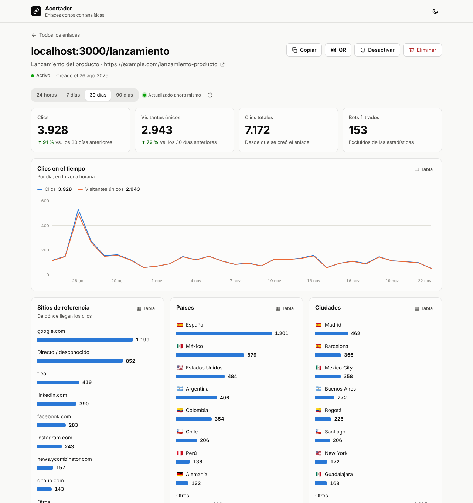
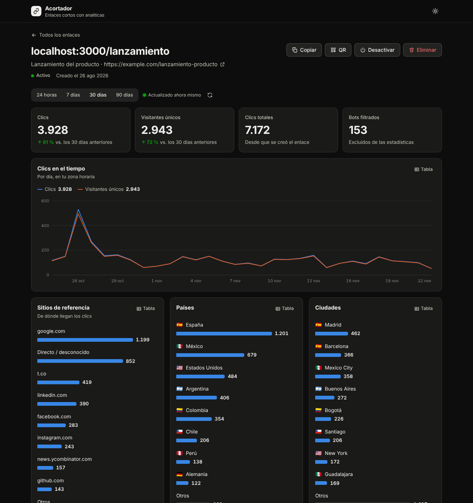
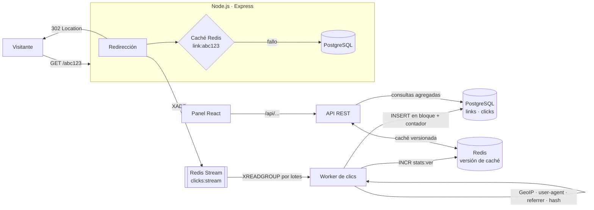

# Acortador de URLs con analíticas

Aplicación full-stack para **acortar enlaces y analizar sus clics**: sitios de referencia (referrers), países y ciudades, dispositivos, navegadores, sistemas operativos y horas de actividad, todo en un panel de control.

**Stack:** Node.js (Express 5) · PostgreSQL · Redis (caché, Streams y rate limiting) · React 19 + Vite · Docker

[](https://render.com/deploy?repo=https://github.com/Andres-DLT/url-shortener)



<details>
<summary>Tema oscuro</summary>


</details>

---

## Funcionalidades

- **Acortar enlaces** con código aleatorio (`/k3x9a2m`) o **alias personalizado** (`/promo-navidad`), título opcional y **fecha de caducidad**.
- **Redirección rápida** (302) servida desde la caché de Redis, con respaldo en PostgreSQL si Redis cae.
- **Seguimiento de clics** sin bloquear la redirección: se encolan en un **Redis Stream** y un worker los vuelca por lotes en PostgreSQL.
- **Analíticas por enlace y globales:**
  - clics y **visitantes únicos** por hora o día, con comparación frente al periodo anterior,
  - **sitios de referencia** (dominio del `Referer`, o "Directo"),
  - **países y ciudades** (GeoIP offline con `geoip-lite`, sin llamadas externas),
  - dispositivos, navegadores y sistemas operativos,
  - mapa de calor **día de la semana × hora** (en la zona horaria del usuario),
  - últimos clics y ranking de enlaces más visitados.
- **Filtro de bots** (crawlers, previsualizadores de enlaces, `curl`…): se guardan, pero no cuentan en las estadísticas.
- **Privacidad:** no se guarda la IP. Se usa un hash SHA-256 con sal de IP + user-agent para contar visitantes únicos.
- **Código QR** en SVG de cada enlace, activar/desactivar (responde `410 Gone`) y eliminar.
- Panel **responsive**, con **tema claro/oscuro**, refresco automático cada 30 s y vista de tabla accesible en cada gráfico.
- **Acceso de administrador** con contraseña (`ADMIN_PASSWORD`) y cookie de sesión firmada (HMAC, `HttpOnly`, `SameSite=Lax`). El panel puede ser **público en solo lectura**, útil como demo o portafolio, o totalmente privado.
- **Rate limiting** por IP en la creación de enlaces y en el inicio de sesión (Redis).

## Arquitectura



### El recorrido de un clic

1. `GET /:code` busca el enlace en Redis (`link:<code>`, TTL 1 h). Si no está, consulta PostgreSQL y lo cachea; los códigos inexistentes también se cachean (30 s) para no castigar la base de datos.
2. Responde **302** con `Cache-Control: no-store`. Con un 301 el navegador cachearía la redirección y dejaríamos de contar clics.
3. Después de responder, hace un `XADD` al stream `clicks:stream` (≈0,1 ms) con la IP, el user-agent, el referer y la marca de tiempo.
4. El **worker** (consumer group `clicks:writers`) lee hasta 500 eventos por lote, enriquece cada uno (país/ciudad, navegador/SO/dispositivo, dominio de referencia, hash del visitante, ¿bot?) y los inserta con un único `INSERT … SELECT FROM unnest(…)` en la misma transacción que actualiza `links.click_count`.
5. Solo entonces hace `XACK` + `XDEL`. Es entrega **al menos una vez**: si el worker muere, los mensajes pendientes se reprocesan al reiniciar o los reclama otro consumidor (`XAUTOCLAIM`). La IP en bruto desaparece del stream en cuanto se procesa.
6. El worker incrementa `stats:ver:<linkId>` y `stats:ver:all`. Las estadísticas cacheadas llevan ese número de versión en la clave, así que **la caché se invalida sola** cuando llegan clics nuevos.

Si Redis no está disponible, la redirección sigue funcionando: el enlace se lee de PostgreSQL y el clic se escribe directamente en la base de datos.

### Qué hace cada pieza

| Componente | Responsabilidad |
|---|---|
| **PostgreSQL** | Fuente de verdad: tabla `links` y tabla `clicks` (un registro por clic, ya anonimizado). Las analíticas son consultas `GROUP BY` / `generate_series` sobre el índice `(link_id, clicked_at)`. |
| **Redis: caché** | `link:<code>` resuelve redirecciones sin tocar Postgres; `stats:<scope>:v<n>:<range>:<tz>` guarda el JSON del panel. |
| **Redis: Streams** | Cola persistente de clics entre la redirección y el worker (con consumer groups, escalable a N workers). |
| **Redis: rate limit** | Ventana fija por IP con `INCR` + `EXPIRE` atómicos (`MULTI`). |
| **Worker** | Enriquecimiento e inserción por lotes. Puede ir dentro del proceso web (`RUN_WORKER_INLINE=true`) o como proceso aparte (`npm run worker`). |
| **React** | Panel con gráficos SVG hechos a mano (sin librerías): línea con cruceta, barras ordenadas, barra segmentada y mapa de calor. |

### Modelo de datos

```sql
links  (id, code, target_url, title, is_active, expires_at, click_count, created_at, updated_at)
       -- índice único sobre lower(code): "Promo" y "promo" son el mismo alias
clicks (id, link_id → links ON DELETE CASCADE, clicked_at, visitor_hash,
        referrer, referrer_domain, country, region, city, browser, os, device, is_bot)
       -- índices (link_id, clicked_at DESC) y (clicked_at DESC)
```

Las migraciones están en `server/src/db/migrations/` y se aplican al arrancar, con un *advisory lock* para que varias instancias no migren a la vez.

---

## Desplegar gratis en producción (Render + Neon)

El repositorio incluye un Blueprint de Render ([`render.yaml`](render.yaml)) para desplegar con un clic sin pagar nada:

| Pieza | Servicio gratuito | Notas |
|---|---|---|
| App (API + redirecciones + panel + worker) | **Render**, web service *free* (Docker) | Se duerme tras 15 min sin tráfico. La primera visita después tarda ~1 min en despertar. |
| Redis | **Render Key Value** *free* (25 MB) | Sin persistencia: si se reinicia, solo se pierden la caché y los clics que estuvieran en cola. |
| PostgreSQL | **Neon** *free* | Permanente. El Postgres gratuito de Render se borra a los 30 días, por eso se usa Neon. |

Pasos:

1. **Base de datos.** Crea una cuenta en [neon.com](https://neon.com) (puedes entrar con GitHub) y un proyecto en la región **AWS US East 2 (Ohio)**, la misma que la app. En *Connect*, copia la cadena de conexión (`postgresql://…?sslmode=require`).
2. **App.** Pulsa el botón **Deploy to Render** de arriba (entra con GitHub) y rellena:
   - `DATABASE_URL`: la cadena de Neon.
   - `ADMIN_PASSWORD`: la contraseña con la que entrarás al panel para crear enlaces.
3. Pulsa **Deploy Blueprint**. En unos minutos tendrás la app en `https://url-shortener-xxxx.onrender.com`, con datos de demostración precargados (`SEED_DEMO_ON_EMPTY=true`).

Las migraciones se aplican solas al arrancar, y cada `git push` a `main` vuelve a desplegar. La URL pública se toma de `RENDER_EXTERNAL_URL`. Si conectas un dominio propio, define `BASE_URL`.

## Puesta en marcha local

### Opción A: Docker (recomendada)

```bash
ADMIN_PASSWORD=elige-una-contraseña docker compose up -d --build
```

Abre **http://localhost:3000**. Se levantan PostgreSQL, Redis, la app (API + panel) y un worker de clics separado. La imagen corre con `NODE_ENV=production`, así que sin `ADMIN_PASSWORD` el panel funciona en solo lectura.

Para cargar **datos de demostración** (6 enlaces con ~25 000 clics repartidos en 90 días):

```bash
docker compose exec app node server/src/scripts/seed.js
```

Para escalar los workers:

```bash
docker compose up -d --scale worker=3
```

Variables útiles para compose: `PORT`, `BASE_URL`, `IP_HASH_SALT`, `TRUST_PROXY` (ver `.env.example`).

### Opción B: desarrollo local

Requisitos: Node.js 22+ (24 LTS recomendado), PostgreSQL 14+ y Redis 6.2+.

```bash
npm run setup                      # instala server/ y client/
cp .env.example .env               # ajusta DATABASE_URL y REDIS_URL si hace falta
npm run seed                       # opcional: datos de demo
```

Si solo necesitas las bases de datos en Docker:

```bash
docker compose up -d postgres redis
```

En ese caso, expón los puertos añadiendo `ports: ["5432:5432"]` y `ports: ["6379:6379"]` a esos servicios.

Arranca en dos terminales:

```bash
npm run dev:server     # API en http://localhost:3000 (recarga al guardar)
```

```bash
npm run dev:client     # panel en http://localhost:5173 (Vite, reenvía /api al 3000)
```

Producción sin Docker: `npm run build`, luego `npm start` (sirve el panel compilado) y, opcionalmente, `npm run worker` con `RUN_WORKER_INLINE=false`.

### Tests

```bash
npm test
```

Hay 33 tests con `node:test` + `supertest`:

- **Unitarios:** generación y validación de códigos, normalización de URLs, referrers, user-agents, bots, GeoIP y hash de visitantes.
- **Integración contra PostgreSQL y Redis reales:** CRUD, alias duplicados, redirecciones, el flujo completo stream → worker → estadísticas, invalidación de cachés, enlaces desactivados (410), borrado en cascada, rate limiting y `/health`.
- **Autenticación:** panel público de solo lectura, panel privado, inicio de sesión, cookies manipuladas y producción sin contraseña (gestión bloqueada).

Por defecto usan la base de datos `shortener_test` y la db 15 de Redis. Se pueden cambiar con `TEST_DATABASE_URL` y `TEST_REDIS_URL`. El workflow `.github/workflows/ci.yml` los ejecuta en GitHub Actions con servicios de Postgres y Redis.

---

## API

Todas las respuestas son JSON. Los errores tienen la forma `{ "error": { "code", "message" } }`.

🔒 = requiere sesión de administrador cuando hay `ADMIN_PASSWORD`. Las rutas de lectura son públicas mientras `PUBLIC_DASHBOARD=true`.

| Método | Ruta | Descripción |
|---|---|---|
| `GET` | `/api/config` | URL base y estado de la sesión (`mode`, `canEdit`, `canView`). |
| `POST` | `/api/auth/login` | `{ password }`: crea la cookie de sesión. Tiene rate limit. |
| `POST` | `/api/auth/logout` | Cierra la sesión. |
| `POST` | `/api/links` 🔒 | Crea un enlace. Cuerpo: `{ url, alias?, title?, expiresAt? }`. Tiene rate limit por IP. |
| `GET` | `/api/links?q=&page=&pageSize=` | Lista paginada con búsqueda por alias, URL o título. |
| `GET` | `/api/links/:code` | Detalle de un enlace. |
| `PATCH` | `/api/links/:code` 🔒 | Actualiza `{ url?, title?, expiresAt?, isActive? }`. |
| `DELETE` | `/api/links/:code` 🔒 | Elimina el enlace y sus clics. |
| `GET` | `/api/links/:code/stats?range=7d&tz=Europe/Madrid` | Estadísticas del enlace. `range`: `24h`, `7d`, `30d` o `90d`. |
| `GET` | `/api/links/:code/qr` | Código QR en SVG. |
| `GET` | `/api/overview?range=&tz=` | Estadísticas globales + enlaces más visitados. |
| `GET` | `/health` | Estado de PostgreSQL y Redis (200 / 503). |
| `GET` | `/:code` | Redirección 302 (404 si no existe, 410 si caducó o está desactivado). |

Ejemplo (con sesión de administrador):

```bash
curl -c cookies.txt -X POST http://localhost:3000/api/auth/login \
  -H 'Content-Type: application/json' -d '{"password": "tu-contraseña"}'
```

```bash
curl -b cookies.txt -X POST http://localhost:3000/api/links \
  -H 'Content-Type: application/json' \
  -d '{"url": "https://ejemplo.com/articulo", "alias": "articulo"}'
```

Respuesta de `/stats` (resumida):

```json
{
  "summary": { "clicks": 3928, "visitors": 2943, "botClicks": 153, "allTimeClicks": 7172,
               "previous": { "clicks": 2054, "visitors": 1712 } },
  "timeseries": { "unit": "day", "points": [{ "t": "2026-11-22T00:00:00", "clicks": 53, "visitors": 51 }] },
  "referrers": { "items": [{ "key": "google.com", "clicks": 1199 }], "other": 120 },
  "countries": { "items": [{ "key": "ES", "clicks": 1201 }], "other": 300 },
  "cities":    { "items": [{ "key": "Madrid", "country": "ES", "clicks": 462 }], "other": 900 },
  "browsers":  { "items": [...] }, "os": { "items": [...] }, "devices": { "items": [...] },
  "activity":  [{ "dow": 1, "hour": 14, "clicks": 36 }],
  "recentClicks": [...],
  "cached": true
}
```

## Configuración

Todas las variables se documentan en [`.env.example`](.env.example). Las más importantes:

| Variable | Por defecto | Descripción |
|---|---|---|
| `BASE_URL` | `http://localhost:3000` | Dominio público con el que se construyen los enlaces cortos. |
| `DATABASE_URL` / `REDIS_URL` | local | Conexiones. |
| `IP_HASH_SALT` | — | **Cámbiala en producción.** Sal del hash de visitantes. |
| `ADMIN_PASSWORD` | — | Contraseña de administración. Sin ella, todo queda abierto en desarrollo y la gestión se bloquea en producción. |
| `PUBLIC_DASHBOARD` | `true` | `true`: el panel se ve sin sesión (solo lectura). `false`: también hace falta sesión para verlo. |
| `SEED_DEMO_ON_EMPTY` | `false` | Carga los enlaces de demostración al arrancar si la base de datos está vacía. |
| `TRUST_PROXY` | `0` | Proxies de confianza (número de saltos o `true`) para leer la IP real de `X-Forwarded-For`. Sin esto, todas las visitas parecerían venir del proxy. |
| `RUN_WORKER_INLINE` | `true` | Ejecuta el worker dentro del proceso web. |
| `STATS_CACHE_TTL` | `60` | Segundos de caché de las estadísticas (además de la invalidación por versión). |

## Estructura

```
├── render.yaml              Blueprint de Render (despliegue gratuito con un clic)
├── docker-compose.yml       Postgres + Redis + app + worker
├── Dockerfile               multi-stage: compila el panel y empaqueta el servidor
├── server/
│   ├── src/
│   │   ├── index.js         arranque (migraciones, HTTP, worker inline)
│   │   ├── worker.js        worker de clics como proceso independiente
│   │   ├── app.js           Express: seguridad, API, panel y redirecciones
│   │   ├── routes/          api.js (REST) · redirect.js (/:code)
│   │   ├── services/        links · clics (productor) · worker (consumidor) · analíticas
│   │   ├── middleware/      autenticación · rate limit · errores
│   │   ├── utils/           validación · códigos · enriquecimiento (geo/UA/referrer)
│   │   ├── db/              migraciones SQL y runner
│   │   └── scripts/         migrate · seed
│   └── test/                unitarios + integración
└── client/
    └── src/
        ├── pages/           HomePage (crear, listar, panel general) · LinkPage
        ├── components/      AnalyticsView, formulario, tabla y charts/ (SVG propios)
        └── lib/             api, formato (es-ES), hooks (router, datos, tema)
```

## Notas

- **GeoIP:** `geoip-lite` incluye una base de datos GeoLite offline. Para actualizarla: `cd server && node node_modules/geoip-lite/scripts/updatedb.js license_key=TU_CLAVE` (requiere una cuenta gratuita de MaxMind). Ten en cuenta que mantiene la base en memoria (~150 MB de RAM). En local, las IPs privadas (`127.0.0.1`) aparecen como "Desconocido".
- **Navegadores headless** (Playwright, Puppeteer…) se identifican como bots y se excluyen de las estadísticas.
- **Un solo administrador:** hay una contraseña para gestionar los enlaces, no cuentas de usuario.

### Ideas para seguir

- Cuentas de usuario y enlaces por propietario.
- Dominios personalizados y parámetros UTM.
- Tablas resumen precalculadas (por hora y día) o TimescaleDB cuando `clicks` crezca a cientos de millones de filas.
- Exportar estadísticas a CSV.
